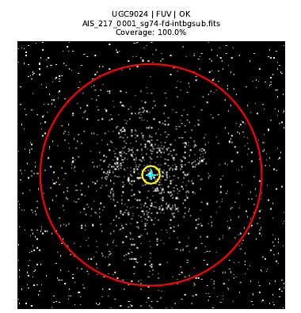
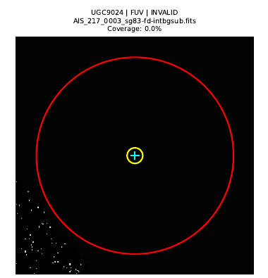

# GALEX image check

Small package for screening individual GALEX FUV/NUV observations before stacking in [ResolvedPopulationPipeline](https://github.com/akhilkrishnar0/resolved-stellar-population-uv-optical).

## What we check

Each galaxy centre is located using the FITS WCS. Observations are flagged when the centre lies outside the image, its nearest pixel is non-finite or zero, or less than 95% of a 2.5-arcmin-radius circle contains finite, nonzero pixels. Flagged observation names are exported for exclusion from stacking; input files are never deleted. Good and flagged images are shown in separate PDFs, three images per row.

| Status | Meaning |
|---|---|
| OK | Valid centre and coverage at least 95% |
| EDGE | Valid centre but insufficient aperture coverage |
| OUTSIDE | Centre or nearest centre pixel outside image |
| INVALID | Non-finite WCS position or invalid centre pixel |
| ERROR | FITS/WCS could not be read or checked |

This preserves the supplied notebook's mean WCS pixel scale and `ceil(pi*r_pixel**2)` area approximation, capped at 100%. Zeros are treated as invalid by default; this is a screening heuristic, not an exposure-map measurement. Negative finite pixels remain valid. Inspect the PDFs and response maps before final selection. The fixed circle does not guarantee coverage of larger requested cutouts. Coordinates in the example catalogue are supplied by the author, not newly verified here.

## Install

```bash
python -m pip install git+https://github.com/akhilkrishnar0/galex-image-check.git
```

## Example 1: inspect observations

Expected files: `downloaded_galex/<galaxy>/<FUV|NUV>/intbgsub/*-intbgsub.fits` (also `.fits.gz`). Download/unpack the observations before running this package.

```python
import pandas as pd
from galex_image_check import CheckConfig,run_check,build_exclusions
catalog=pd.read_csv('https://raw.githubusercontent.com/akhilkrishnar0/galex-image-check/main/examples/catalog.csv')
config=CheckConfig(radius_arcmin=2.5,plot_arcmin=3.0,min_coverage=0.95)
df=run_check(catalog,base_dir='downloaded_galex',config=config)
print(df.groupby(['galaxy','band','status']).size())
exclude=build_exclusions(df)
```

Outputs in `galex_image_check_results/`: `GALEX_field_edge_check.csv`, `GALEX_GOOD_images.pdf`, `GALEX_INVALID_images.pdf`, `exclusions.json`, `missing_observations.csv`, and `settings.json`. Missing bands are reported, not accepted as good observations. Increase `radius_arcmin` for a larger region to be checked; `plot_arcmin` changes only the displayed half-width. Set `zero_is_invalid=False` to retain finite zero-valued pixels.

CLI after downloading the example catalogue:

```bash
galex-image-check examples/catalog.csv --base-dir downloaded_galex --radius-arcmin 2.5
```

## Example 2: exclude flagged inputs in ResolvedPopulationPipeline

Run Example 1 and inspect both PDFs first. Install the combined pipeline separately.

```python
from resolved_uv_optical import ResolvedPopulationPipeline
pipe=ResolvedPopulationPipeline(base_dir='.')
exclude=build_exclusions(df)
# Merge any additional visual rejections into exclude before processing.
report=pipe.process(catalog,galex_exclude=exclude)
```

The converter maps `*-intbgsub.fits[.gz]` to `*-int.fits`, preserving observation IDs and FUV/NUV identifiers. The combined pipeline stacks intensity/rrhr pairs, not the checked intbgsub images. Its existing validation rejects unknown exclusions and bands with no selected inputs. Review missing bands and ensure every intended stacking observation has a checked intbgsub counterpart. An explicit galaxy entry overrides that galaxy's saved exclusions, so merge previous manual rejections if needed. Processing also requires the previously downloaded DECaLS products.

## Supplied results: good and invalid examples

Original author-supplied reports, included unchanged: [good observations](results/GALEX_GOOD_images.pdf) and [flagged observations](results/GALEX_INVALID_images.pdf). These are historical reports from the supplied workflow, not a new run of this package. The previews below are cropped from page 1 of each report.

| Good: UGC9024 FUV, 100% coverage | Invalid: UGC9024 FUV, 0% coverage |
|---|---|
|  |  |

Good: `AIS_217_0001_sg74-fd-intbgsub.fits`. Invalid: `AIS_217_0003_sg83-fd-intbgsub.fits`. Red: 2.5-arcmin check radius; cyan: catalogue centre; yellow: 8-pixel locator. Images are GALEX observations displayed by the author's supplied code.

## Validation

Synthetic FITS checks cover good, edge, outside, invalid, unreadable and missing observations, gzip inputs and exclusion-name conversion. Supplied PDFs are preserved byte-for-byte. Original science FITS files were not supplied, so scientific classifications have not been rerun.
